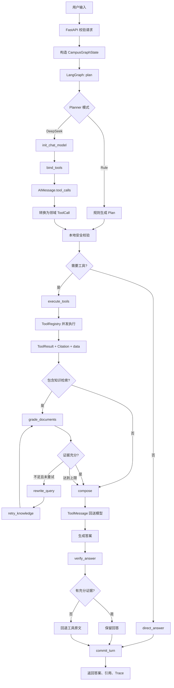

# Campus Agent 学习总结：模型、工具、LangGraph 与完整调用链

> 整理日期：2026-09-04  
> 适用版本：当前 Campus Agent 主链（LangGraph + LangChain 原生工具调用）

本文整理前期讨论中的重要概念，并对应到 Campus Agent 当前代码。推荐先建立整体概念，再沿文件阅读具体实现。

---

## 1. 核心名词速查

| 名词 | 含义 | 在本项目中的位置 |
|---|---|---|
| Agent | 能根据问题决定下一步动作、选择工具并根据结果继续处理的程序 | `CampusGraphAgent` |
| Workflow | 开发者预先定义节点、分支、循环和结束条件的流程 | Campus 的 LangGraph 状态图 |
| LangChain | 模型、消息和工具调用的统一抽象，也提供预置 Agent | DeepSeek 的 `init_chat_model`、`bind_tools`、`AIMessage`、`ToolMessage` |
| LangGraph | 面向有状态 Agent/Workflow 的低层编排引擎 | `StateGraph`、节点、条件边、Checkpoint、`invoke/stream` |
| Tool | Agent 可以调用的外部能力或本地函数 | 课程查询、校园知识检索、校园服务状态查询 |
| Prompt Engineering | 设计模型输入、约束、上下文和输出目标 | 工具决策 Prompt、答案生成 Prompt |
| Memory | 跨回合保存的对话信息 | CLI 内存、Web SQLite Checkpoint 中的 `history` |
| RAG | 先检索资料，再基于资料生成或组织答案 | `search_campus_knowledge` |
| BM25 | 基于词频、逆文档频率和文档长度的关键词相关性算法 | 本地知识库的词法召回通道 |
| MCP | 让模型应用用统一协议连接外部工具、资源和提示模板 | 当前 Campus 未接入 |
| MVP | 用最小功能验证核心价值的可运行版本 | 最早的规则 Planner + 两个本地工具 + 内存记忆 |
| FastAPI | Python Web API 框架 | 对外提供聊天、历史、知识库和指标接口 |
| Dify | 可视化 AI 应用与工作流平台 | 当前项目未使用 |
| Docker | 打包和运行应用的容器技术 | 可用于部署 Dify 或 Campus，本身不是 Agent 框架 |

### Dify 与 Docker 的关系

Dify 是应用，Docker 是运行和部署应用的一种方式。Dify 官方部署经常使用 Docker Compose，但两者不是同一层：

```text
Docker / Docker Compose：提供容器运行环境
                 ↓
Dify：运行在容器中的 AI 应用平台
```

Campus 也可以被打包进 Docker，但使用 Docker 不代表使用了 Dify。

---

## 2. Agent 与 Workflow 的区别

### Workflow

Workflow 的路径主要由开发者确定：

```text
输入 → 步骤 A → 条件判断 → 步骤 B/C → 输出
```

优点是稳定、可测试、成本和风险容易控制；缺点是面对未知任务时灵活性较低。

### Agent

Agent 会让模型参与决策：

```text
输入 → 模型判断 → 选择工具 → 观察结果 → 决定下一步
```

优点是灵活；缺点是路径、成本和失败方式更难预测。

### Campus 属于哪一种

Campus 是“受 Workflow 约束的 Agent”：

- 模型可以决定是否调用工具、调用哪些工具以及传入什么参数；
- 开发者用 LangGraph 固定 Grade、Rewrite、Verify、最大检索次数和最终提交边界；
- 模型有决策权，但没有无限循环和任意执行权。

因此它同时具有 Agent 的动态选择能力和 Workflow 的可控性。

---

## 3. LangChain 与 LangGraph 的分工

二者不是竞争关系，而是上下层关系。

### LangChain 负责什么

当前生产链使用 LangChain 处理：

- `init_chat_model()`：用统一入口初始化 DeepSeek ChatModel；
- `bind_tools()`：把工具名称、描述和 JSON Schema 提供给模型；
- `HumanMessage`、`AIMessage`、`ToolMessage`：表达标准模型对话和工具调用关系；
- 供应商无关的 `AIMessage.tool_calls`。

如果任务只是普通的“模型—工具—模型”循环，可以直接使用 LangChain `create_agent()`。项目中的 `langchain_agent.py` 就是这一模式的独立教学 Demo。

### LangGraph 负责什么

当前生产链使用 LangGraph 处理：

- `StateGraph`：定义整张状态图；
- State：保存节点之间共享的数据；
- Node：执行规划、工具、评分、改写、回答和验证；
- Edge：定义固定跳转；
- Conditional Edge：根据 State 选择分支；
- Checkpointer：保存会话状态；
- `invoke()` / `stream()`：运行整张图。

### “官方框架”与“自己设计”分别指什么

Campus 没有自己实现 LangGraph。准确表达是：

```text
项目自己设计的业务工作流
┌──────────────────────────────────────┐
│ Plan → Tool → Grade/Rewrite           │
│              → Compose → Verify       │
│              → Commit                 │
│                                      │
│ ToolRegistry / Citation / RAG 规则    │
└──────────────────────────────────────┘
                   ↓ 运行在
┌──────────────────────────────────────┐
│ 官方 LangGraph                       │
│ StateGraph / Node / Edge / Checkpoint│
└──────────────────────────────────────┘
```

所以：

- 图运行引擎是官方 LangGraph；
- 节点划分、状态字段和质量控制是项目自定义；
- DeepSeek 的消息与工具调用协议使用 LangChain 标准抽象；
- 工具安全执行和结构化 Citation 仍由项目控制。

---

## 4. Domain：为什么先定义领域数据

`campus_agent/domain.py` 只描述模块之间传递的数据，不执行模型或工具调用。

这样可以避免 Planner、LangGraph、工具、Web 和存储层分别发明不兼容的数据格式。

### `@dataclass(frozen=True, slots=True)`

```python
@dataclass(frozen=True, slots=True)
class Message:
    role: ConversationRole
    content: str
```

含义：

- `@dataclass`：自动生成 `__init__`、`__repr__`、`__eq__` 等方法；
- `frozen=True`：创建后不允许重新给字段赋值，降低消息被意外修改的风险；
- `slots=True`：固定对象字段，阻止随意增加属性，并减少大量小对象的内存开销。

它是“定义类”的装饰器，不是一次模型调用。

### 为什么 Message 有 `role` 和 `content`

```python
Message(role="user", content="周三有什么课？")
Message(role="assistant", content="周三有两门课……")
```

- `role` 表示这段内容由谁产生；
- `content` 保存消息正文；
- 同一句话由 `user` 和 `assistant` 发送，模型理解出的语义位置不同；
- 多条消息按顺序组成会话历史。

当前持久化历史只允许：

```python
ConversationRole = Literal["user", "assistant"]
```

系统 Prompt 和工具结果不混入长期会话历史，而是在模型调用时按需构造。

### 字典消息和消息对象

基础字典形式：

```python
{"role": "user", "content": "周三有什么课？"}
```

LangChain 对象形式：

```python
HumanMessage("周三有什么课？")
AIMessage("周三有两门课……")
```

两种方式表达的是同一类信息，但用途不同：

- `MessagePayload`/字典适合 JSON、SQLite 和 LangGraph State；
- `HumanMessage`、`AIMessage`、`ToolMessage` 适合模型 API 和标准工具调用；
- `Message` 是项目稳定的领域对象，负责运行时校验。

当前转换边界是：

```text
SQLite / Graph State 字典
          ↓ Message.from_dict()
项目 Message
          ↓ 按模型调用需要转换
HumanMessage / AIMessage
```

---

## 5. 模型与 Tool 的关系

最重要的原则：

> 模型负责提出工具调用请求，程序负责验证和真正执行工具。

### `bind_tools()` 做了什么

```python
model_with_tools = model.bind_tools(tool_schemas)
response = model_with_tools.invoke(messages)
```

`bind_tools()` 把以下信息交给模型：

```json
{
  "name": "query_courses",
  "description": "按星期查询课程",
  "parameters": {
    "type": "object",
    "properties": {
      "weekday": {"type": "string"}
    },
    "required": ["weekday"]
  }
}
```

模型可能返回：

```python
AIMessage(
    content="",
    tool_calls=[
        {
            "id": "call-123",
            "name": "query_courses",
            "args": {"weekday": "周三"},
        }
    ],
)
```

这只代表：

```text
模型建议调用 query_courses(weekday="周三")
```

并不代表工具已经执行。

### 本地工具与服务端工具

用户示例中的：

```python
tool = {"type": "web_search"}
```

可能是模型供应商管理的服务端工具，供应商可以在一次模型请求中完成搜索。

Campus 的工具是本地 Python 工具：

- `query_courses`
- `search_campus_knowledge`
- `query_campus_service_status`

它们必须由本地程序执行，不能由模型服务器直接运行。

### Campus 为什么继续保留 ToolRegistry

当前没有直接用官方 `ToolNode` 替换全部执行层，因为项目需要保留：

- 工具白名单；
- 参数和异常边界；
- `ToolOutput.text`；
- 结构化 `Citation`；
- RAG 命中文档 `data`；
- Grade 和 Verify 所需的内部证据。

因此当前组合是：

```text
LangChain：标准化模型消息和 tool_calls
ToolRegistry：安全执行本地工具
LangGraph：控制工具前后的业务流程
```

---

## 6. Prompt Engineering 用在哪些环节

Prompt Engineering 不是只写一句“你是一个助手”，而是贯穿模型调用前后的约束设计。

当前主要有两个 Prompt。

### 工具决策 Prompt

作用：

- 告诉模型 Campus 的身份和能力边界；
- 要求课程、地点、时间、办事规则等事实必须调用工具；
- 限制每轮最多四个工具；
- 限制每轮最多一次知识检索；
- 缺少参数时先澄清；
- 简单问候可以直接回答；
- 明确模型只提出调用请求，不执行工具。

### 回答生成 Prompt

作用：

- 只允许使用工具结果中的事实；
- 工具失败时明确说明；
- 保留来源和业务数据标签；
- 禁止根据常识补充课程、地点、金额、时间和流程；
- 使用简洁中文回答。

Prompt 是第一层约束，但不能把安全完全交给 Prompt。Campus 还有程序级校验、ToolRegistry、Grade 和 Verify。

---

## 7. 当前从输入到回答的完整流程

以问题为例：

```text
周三有什么课程？校园卡丢了怎么补办？
```

### 总体流程图



### 第一步：FastAPI 接收并校验

Web 请求包含：

```json
{
  "query": "周三有什么课程？校园卡丢了怎么补办？",
  "session_id": "student-001",
  "planner": "deepseek"
}
```

FastAPI 负责输入长度、Planner 枚举、session 格式、CSRF、Origin 和并发会话边界。

### 第二步：建立 Graph State

```python
{
    "query": "...",
    "session_id": "student-001",
    "history": [...],
    "tool_calls": [],
    "tool_results": [],
    "retrieved_documents": [],
    "citations": [],
    "answer": "",
    "events": [],
}
```

State 是节点共享的工作区，不等于模型消息列表。

### 第三步：Plan

Rule 模式完全离线生成领域 `Plan`。

DeepSeek 模式执行：

```text
历史 Message
    ↓
HumanMessage / AIMessage
    ↓
bind_tools(工具 Schema)
    ↓
模型 invoke
    ↓
AIMessage.tool_calls
    ↓
领域 ToolCall
```

模型工具调用还要经过本地校验：

- 是否是已注册工具；
- 参数类型是否正确；
- 必需参数是否存在；
- 是否包含未知参数；
- 调用数量是否超过限制；
- 是否出现重复调用或重复 call id。

模型生成未知工具时不会执行，而是安全回退规则 Planner。

### 第四步：Execute Tools

LangGraph 调用 `ToolRegistry.execute()`，而不是让模型执行 Python 函数。

同一轮独立工具可以并发：

```text
                       ┌─ query_courses(周三)
execute_tools ─────────┤
                       └─ search_campus_knowledge(校园卡补办)
```

并发完成后仍按原计划顺序整理 `ToolResult`、Citation 和 Trace。

### 第五步：Grade / Rewrite / Retry

普通课程工具可以直接进入 Compose。知识检索需要判断证据质量：

```text
Retrieve #1
    ↓
Grade
    ├─ relevant → Compose
    └─ insufficient
           ↓
        Rewrite
           ↓
        Retrieve #2
           ↓
        Grade → Compose
```

Rewrite 当前只做保守别名替换，例如：

```text
一卡通 → 校园卡
不见了 → 遗失
重办 → 补办
```

最多检索两轮，防止无限循环。

### 第六步：Compose

工具请求和工具结果按照标准消息协议组成：

```text
HumanMessage：当前问题
      ↓
AIMessage：tool_calls
      ↓
ToolMessage：课程结果，关联 call id
      ↓
ToolMessage：知识结果，关联 call id
      ↓
AIMessage：最终回答
```

`ToolMessage.artifact` 保存 Citation 和结构化数据，模型主要阅读 `content`。

### 第七步：Verify

当前 Verifier 检查：

- 是否存在成功工具结果；
- 知识回答是否有 Citation；
- Citation 是否属于本轮检索 hits；
- 回答新增的时间、金额和业务编号是否存在于证据。

验证失败时不保留无依据回答，而是回退到工具原文。

### 第八步：Commit

只有完整回合成功后才保存：

```python
Message(role="user", content="用户问题")
Message(role="assistant", content="最终回答")
```

这样可以避免节点异常后留下只有用户问题的半个回合。

### 第九步：返回结果

API 最终返回：

```json
{
  "answer": "最终回答",
  "citations": [],
  "events": [
    {"type": "plan", "detail": "..."},
    {"type": "tool_result", "detail": "..."},
    {"type": "grade", "detail": "..."},
    {"type": "verify", "detail": "..."},
    {"type": "final", "detail": "..."}
  ]
}
```

---

## 8. `invoke` 和 `stream` 在当前项目中的含义

需要区分两层调用。

### Graph 层

```python
graph.invoke(state)
```

运行整张图并一次性返回最终 State。

```python
graph.stream(state, stream_mode="updates")
```

图中每完成一个节点就产生一次状态更新，Web 用它输出 SSE Trace。

### Model 层

```python
model.invoke(messages)
```

只调用一次模型。

当前 DeepSeek 初始化设置 `streaming=False`，因此模型返回完整 `AIMessage`，不是逐 token 输出。网页的“流式”目前指：

```text
Plan 完成
→ Tool 完成
→ Grade 完成
→ Verify 完成
→ 最终结果
```

而不是答案一个字一个字出现。

---

## 9. RAG 和 BM25

### RAG 是什么

RAG（Retrieval-Augmented Generation）表示：

```text
用户问题
   ↓
从知识库检索相关文档
   ↓
把证据交给模型或回答器
   ↓
生成带来源的回答
```

它解决的是“模型参数中没有最新或私有资料”的问题，但不能自动保证检索结果一定相关，所以 Campus 增加了 Grade、Rewrite 和 Verify。

### BM25 是什么

BM25 是一种经典关键词检索算法，主要考虑：

- 查询词在文档中出现的频率；
- 该词在所有文档中是否稀有；
- 文档长度；
- 词频增长的饱和效果。

直观理解：

> 一个词在当前文档中多次出现、在其他文档中比较少见，并且当前文档不是靠超长正文堆出来的，那么它更能代表相关性。

Campus 使用：

```text
BM25 词法召回
       +
Vector 语义召回
       ↓
Weighted RRF 融合排序
```

BM25 擅长课程代码、编号、时间和精确关键词；向量检索擅长语义相近但措辞不同的问题。

---

## 10. Memory 与 Checkpoint

Memory 表示 Agent 能在后续回合读取前面的对话，例如：

```text
用户：周三有什么课？
助手：……
用户：在哪里上？
```

第二个问题必须结合第一轮才能理解“哪里”。

当前实现：

- CLI：使用 `ConversationMemory`，进程结束后消失；
- Web：使用 LangGraph SQLite Checkpointer，按 `thread_id` 持久化；
- `session_id` 映射为 `campus:<session_id>`；
- 只把 `history` 作为跨回合持久状态；
- 工具结果、文档正文和临时计划使用 `UntrackedValue`，不长期写入 Checkpoint；
- `/clear` 或网页“清空会话”会删除当前 thread。

之前出现“这个会话记录能删除吗”仍返回固定能力说明，是 Rule Planner 把控制类问题当成不支持问题。当前已增加问候和会话清理意图，能够给出真实操作方式。

---

## 11. FastAPI 在架构中的位置

FastAPI 不是 Agent，也不负责模型推理。它是 Agent 对外提供 Web 服务的接口层：

```text
浏览器
   ↓ HTTP / SSE
FastAPI
   ↓ Python 方法调用
CampusGraphAgent
   ↓
LangGraph / Model / Tools
```

所以可以说：

> 这是一个通过 FastAPI 暴露 Campus Agent 能力的 Web 服务演示。

不能说“FastAPI 搭建了 Agent”；Agent 的核心流程由 LangGraph 和各业务模块实现。

---

## 12. MCP 与当前项目的关系

MCP（Model Context Protocol）是一种连接 AI 应用与外部能力的标准协议，可暴露：

- Tools：可执行操作；
- Resources：可读取资源；
- Prompts：可复用提示模板。

当前 Campus 的工具是进程内 Python 对象：

```text
LangGraph → ToolRegistry → Python Tool
```

如果将来接入 MCP，可以变成：

```text
LangGraph → MCP Client → MCP Server → 校园系统
```

MCP 可以统一远程工具接入，但不会替代 LangGraph 的业务编排、RAG 质量控制和 Checkpoint。

---

## 13. 本轮架构优化结果

旧 DeepSeek 主链：

```text
Prompt 中手写工具描述
→ 要求模型返回自定义 JSON Plan
→ 手工解析 JSON
→ ToolRegistry
→ 再要求模型返回 JSON Answer
```

存在的问题：

- 重复维护工具协议；
- Prompt 更长、更脆弱；
- 没有标准 `tool_call_id`；
- 没有标准 `AIMessage/ToolMessage` 生命周期；
- 与 LangChain 生态衔接较弱。

当前主链：

```text
init_chat_model
→ bind_tools
→ AIMessage.tool_calls
→ 本地校验
→ ToolRegistry 并发执行
→ ToolMessage
→ 模型回答
```

保留的项目能力：

- 自定义 LangGraph 工作流；
- Rule 离线模式和失败回退；
- 工具白名单与异常隔离；
- Citation 和结构化 ToolResult；
- Grade/Rewrite/Retry；
- Verify；
- SQLite Checkpoint；
- SSE 节点 Trace。

旧 `deepseek_planner.py` 和兼容 HTTP Client 仍保留用于旧调用方与回归测试，但不再是 CLI/Web 默认 DeepSeek 在线路径。

当前自动化验证结果：

```text
186 passed, 28 subtests passed
```

真实 DeepSeek 联调仍需要有效 `DEEPSEEK_API_KEY`。

---

## 14. 当前架构仍可继续优化的部分

下面是后续方向，不代表当前实现错误：

1. **Token Streaming**：把模型层改为 `astream()`，让最终答案逐 token 输出；
2. **有界工具纠错循环**：工具参数或执行失败时，把错误作为 `ToolMessage` 返回模型，允许最多重新决策一次；
3. **更完整的 Verifier**：加入 NLI、LLM Judge 和更大的对抗评测集；
4. **统一 Tool Adapter**：让现有 `ToolOutput` 与 LangChain `BaseTool/ToolNode` 建立正式适配层；
5. **细粒度 Trace**：为 Retriever、ToolRegistry 和业务 Gateway 添加独立 Span；
6. **Human-in-the-loop**：未来写操作必须增加 `interrupt()`、审批、幂等和审计；
7. **生产部署能力**：登录鉴权、限流、Secret 管理、HTTPS、多实例 Checkpoint 和跨实例 session 锁。

---

## 15. 推荐代码阅读顺序

按照“数据 → 工具 → 模型 → 图 → 服务”的顺序阅读：

1. `campus_agent/domain.py`  
   理解 `Message`、`ToolCall`、`ToolOutput`、`ToolResult`、`Citation`、`Plan`。

2. `campus_agent/tooling.py`  
   理解 `Tool` 接口和 `ToolRegistry` 安全执行边界。

3. `campus_agent/tools/course.py`  
   阅读最简单、最确定的课程工具。

4. `campus_agent/tools/knowledge.py`  
   理解工具怎样返回文本、Citation 和 RAG hits。

5. `campus_agent/planner.py`  
   理解完全离线的 Rule Planner 和降级逻辑。

6. `campus_agent/tool_calling_planner.py`  
   重点理解 `init_chat_model`、`bind_tools`、`AIMessage.tool_calls` 和 `ToolMessage`。

7. `campus_agent/graph/state.py`  
   理解哪些数据跨节点共享、哪些数据允许持久化。

8. `campus_agent/graph/nodes.py`  
   理解 Plan、并发工具执行、Grade、Rewrite、Compose、Verify 和 Commit。

9. `campus_agent/graph/workflow.py`  
   理解节点如何通过固定边和条件边组成完整状态图。

10. `campus_agent/web.py`  
    理解 FastAPI、SSE、session 锁、SQLite 和安全边界。

11. `tests/test_tool_calling_planner.py`  
    通过离线 Fake ChatModel 理解标准工具调用协议如何被验证。

---

## 16. 一句话总结整个项目

> Campus Agent 通过 FastAPI 接收问题，由 LangGraph 控制有界业务流程；Rule 或 DeepSeek 决定工具调用，DeepSeek 使用 LangChain 标准 `bind_tools/AIMessage/ToolMessage` 协议；本地 ToolRegistry 安全执行课程、RAG 和业务工具，知识结果经过 Grade、Rewrite 和 Verify，最后把完整回答、Citation 和 Trace 返回用户，并通过会话 Memory/Checkpoint 支持追问。

